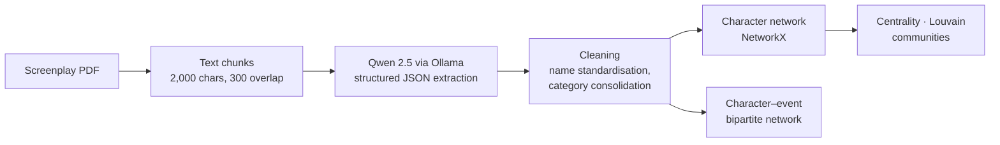

# Oppenheimer Script Network Analysis: LLM extraction and network science

This project uses a locally run LLM to turn an unstructured film script into structured relationship data, then analyses the resulting character network to find the central figures, the communities and the events that drive the story of *Oppenheimer* (2023).

## Pipeline

1. **Extraction.** The script is split into overlapping chunks with LangChain. A local LLM (Qwen 2.5, run with Ollama) extracts every interaction into a fixed schema: `from`, `to`, relationship type, theme and sentiment. A second prompt links characters to key events as either active or passive participants.
2. **Cleaning.** The LLM's output was messy, so I merged name variants (*"Niels Bohr"* → *Bohr*, *"Kitty Oppenheimer"* → *Kitty*), removed generic speakers (*"Crowd"*, *"Young Man"*) and consolidated overlapping relationship and theme categories.
3. **Analysis.** The project builds a weighted character graph and uses it to compute degree, betweenness, closeness and eigenvector centrality, detect communities with the Louvain algorithm, and analyse a bipartite character–event network.

## Key findings

- **434 extracted relationships** produce a final network of **42 characters and 109 connections** (density 0.13).
- **Oppenheimer is the clear hub.** **Strauss** comes second, and Strauss–Oppenheimer is the most frequent interaction in the script, ahead of Oppenheimer–Kitty and Oppenheimer–Groves.
- **Tight groups, few bridges.** The average clustering coefficient is high (0.73) but transitivity is low (0.20). Characters form close local groups that connect to each other through a few central figures.
- **"Ambition and Power"** is the dominant theme in every detected community.
- In the event network, the **Senate Hearing**, the **Security Clearance Review** and the **Trinity test** are the most connected events.

## Repository contents

| File | Description |
|---|---|
| `NLP_Oppenheimer.ipynb` | Full pipeline: extraction, cleaning, network analysis and visualisations |
| `extracted_relationships.json` | 434 character–character relationships extracted by the LLM |
| `extracted_bipartite.json` | Character–event interactions extracted by the LLM |

The screenplay itself isn't included for copyright reasons. The extracted JSON files are enough to reproduce the whole network analysis.

## Limitations and next steps

- The LLM's extractions haven't been checked against human labels. The next step is to hand-annotate a sample of chunks and measure precision and recall, so it's clear how far the network can be trusted.
- Repeated runs of the LLM may give different results. Fixing the temperature and comparing several runs would quantify that variation.

## Tech stack

Python · Ollama (Qwen 2.5) · LangChain · PyMuPDF · NetworkX · python-louvain · pandas · matplotlib
